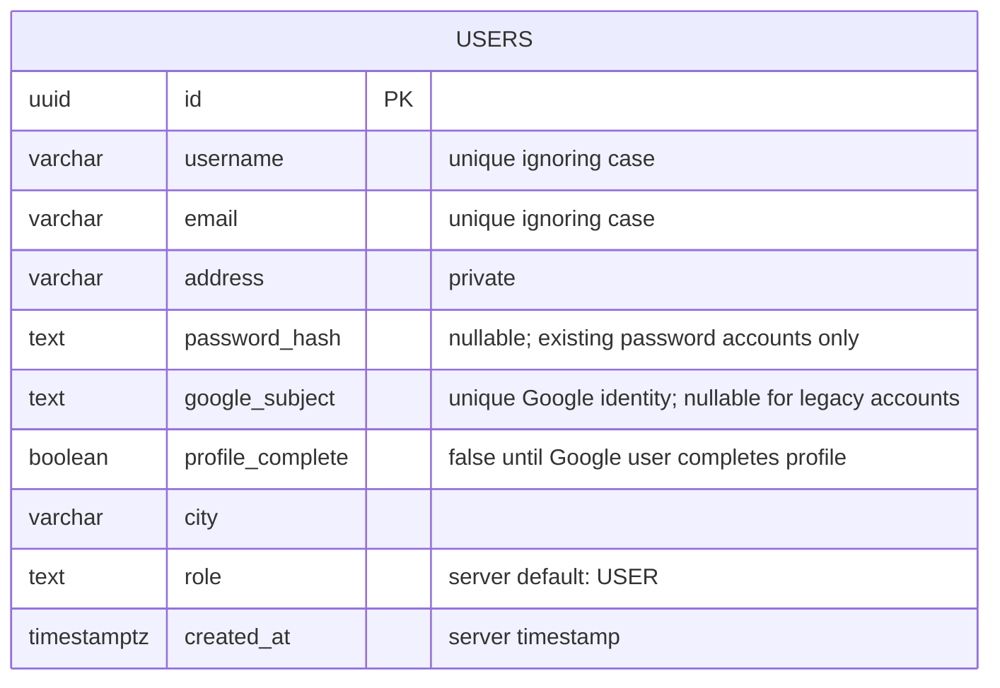
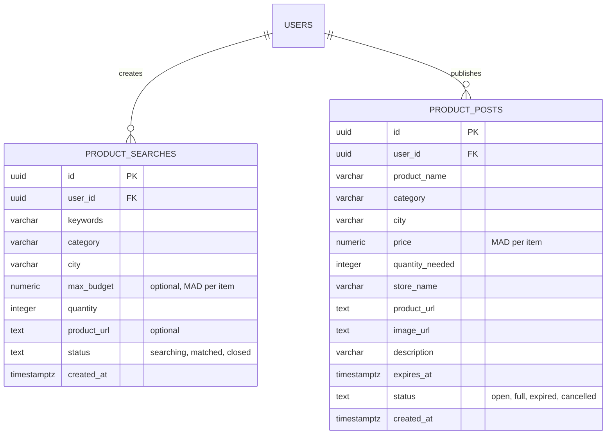

# Account database

The application uses PostgreSQL directly through the `pg` driver. No ORM is needed. The database stores accounts, product searches, product posts and migration history. Legacy group and review features remain paused.

## Account table



Google signup verifies the email and stable Google subject, then stores the account without a password hash. Users provide username, address and city on the profile screen. Existing password accounts retain their bcrypt hash and login. The server assigns `id`, `role` and `created_at`; client-supplied roles are discarded. Unique indexes prevent duplicate emails, usernames and Google identities. See [Google setup](GOOGLE_SIGN_IN.md).

## Search and post records



`002_product_activity.sql` adds the two tables and nullable `users.starting_preference` (`search` or `post`). One user can own any number of both record types. Choosing a different action never changes their user ID, account role or existing records. Existing users keep their accounts, with no preference until they choose.

Owners can update their search status and post status. Public discovery includes only open posts with a future expiry. An open/full post whose expiry has passed is returned as `expired`; this expiry status is derived from the timestamp when read. Private searches are accessible only through the signed-in user's `mine` endpoint.

Matching uses keyword terms against product names/descriptions, case-insensitive city/category, a maximum price per item, and a quantity the deal can accommodate. Closed, full, cancelled and expired posts are excluded. The owner marks a search matched when appropriate; finding candidates does not change its status automatically.

Endpoints:

| Endpoint                                 | Purpose                                                    |
| ---------------------------------------- | ---------------------------------------------------------- |
| `PATCH /api/auth/preference`             | Save the current account's search/post preference          |
| `POST /api/product-searches`             | Save a search request for the signed-in user               |
| `GET /api/product-searches/mine`         | List only the current user's searches                      |
| `PATCH /api/product-searches/:id/status` | Update an owned search status                              |
| `POST /api/product-posts`                | Save a product post for the signed-in user                 |
| `GET /api/product-posts`                 | Browse public, open and unexpired posts with filters       |
| `GET /api/product-posts/mine`            | List all current-user posts, including closed/expired ones |
| `PATCH /api/product-posts/:id/status`    | Update an owned post status                                |

Routes, controllers, validation, repositories and record types live in the named `backend/src/modules/product-searches` and `backend/src/modules/product-posts` folders. The forms, activity page, browsing and API calls live in `frontend/src/features/products`. The action choice is in `frontend/src/features/onboarding`.

## Request flow

```text
Continue with Google
  → GET /api/auth/google redirects to Google
  → Google verifies the user's identity
  → callback verifies state, PKCE, signature, audience, issuer, expiry and nonce
  → repository creates or finds the account by Google subject
  → HTTP-only cookie stores the app session
  → PATCH /api/auth/profile saves username, address and city
  → user chooses Search or Post
```

Existing password login verifies the saved hash. `/api/auth/me` restores the current account after reload. Logout clears the HTTP-only cookie. The browser does not save passwords, JWTs or the account address in local storage. Production cookies require HTTPS.

## Responsible files

| File                                                     | Job                                                                   |
| -------------------------------------------------------- | --------------------------------------------------------------------- |
| `backend/database/migrations/003_google_accounts.sql`    | Adds Google identity, profile completion and temporary login state    |
| `backend/database/migrations/001_create_users.sql`       | Defines account columns and unique indexes                            |
| `backend/src/database/connection.ts`                     | Manages PostgreSQL connections, parameterized queries and safe errors |
| `backend/src/database/migrate.ts`                        | Applies versioned SQL migrations inside a transaction                 |
| `backend/src/modules/auth/auth.schemas.ts`               | Validates account input                                               |
| `backend/src/modules/auth/auth.repository.ts`            | Reads and inserts user records                                        |
| `backend/src/modules/auth/auth.service.ts`               | Hashes passwords and verifies login credentials                       |
| `backend/src/modules/auth/auth.controller.ts`            | Returns account responses and manages session cookies                 |
| `frontend/src/features/auth/pages/AuthPage.tsx`          | Shows Google signup and existing password login                       |
| `frontend/src/features/auth/services/auth.service.ts`    | Calls the backend account APIs                                        |
| `frontend/src/features/auth/components/AuthProvider.tsx` | Keeps the signed-in user in memory and restores the session           |

## Setup

Create a dedicated PostgreSQL database and a database user with access to it. Put their connection string in `backend/.env` as `DATABASE_URL`. Set a random `JWT_SECRET`; the example secret is not suitable for a deployed app.

For this workspace, the database `letsbuytogether` and the local connection are already configured. The Linux account connects over the local PostgreSQL socket. On another machine, change the connection to match that environment.

```bash
npm run install
npm run db:migrate
npm run dev:back
# In a second terminal:
npm run dev:front
```

The migration runner records applied files in `schema_migrations` and can be run again safely. It does not start or create the PostgreSQL service itself.

## Tests

The normal unit tests check authentication and product validation. Real database tests run only when `TEST_DATABASE_URL` points to a separately migrated database whose name ends in `_test`. They insert uniquely named test accounts and remove only those accounts afterward.

```bash
DATABASE_URL="your-test-database-url" npm run db:migrate
TEST_DATABASE_URL="your-test-database-url" npm test
```

Tests cover account creation, both product workflows, saved preferences, ownership, private data protection, matching filters, optional fields, statuses, expiry, legacy password hashing, Google identity conflicts, callback replay protection, profile validation and cookie sessions.

References: [node-postgres parameterized queries](https://node-postgres.com/features/queries), [OWASP password storage guidance](https://cheatsheetseries.owasp.org/cheatsheets/Password_Storage_Cheat_Sheet.html).

## Profile extension

`005_account_profile.sql` adds nullable `phone`, `bio`, `avatar` (processed WebP bytes) and `avatar_updated_at` to users. These fields are private. See [Profile and browsing](PROFILE.md) for endpoints and upload limits. The earlier search-request tables remain for existing data; their separate UI has been removed in favor of Browse products.
